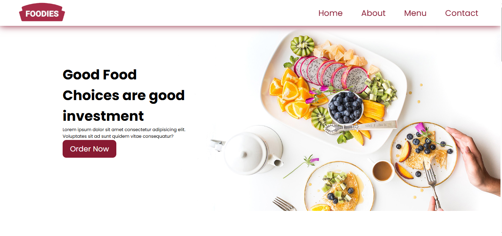
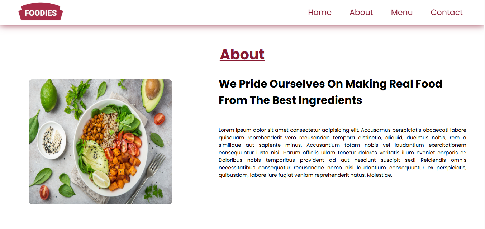
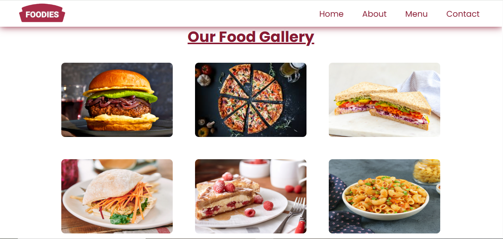
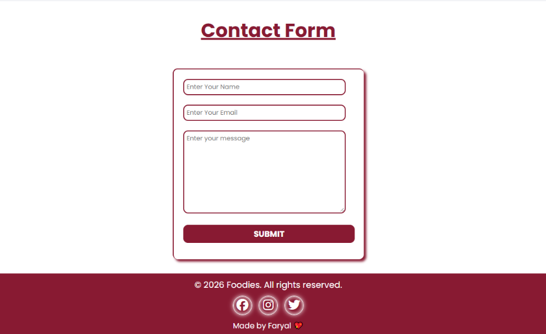

# Foodies – Food Ordering Landing Page

## About The Project
Foodies is a responsive food ordering landing page designed to showcase delicious food and provide users with an attractive and user-friendly browsing experience.

This project was developed as part of the **Oasis Infobyte Web Development and Designing Internship – Level 1, Task 1 (Landing Page).**

## Live Demo
https://food-websit.netlify.app

## Features
- Fixed navigation bar with Home, About, Menu, and Contact links.
- Attractive hero section with a headline, description, and Order Now button.
- About section introducing the website.
- Food gallery showcasing different food items.
- Contact form for user inquiries.
- Footer with social media links (Facebook, Instagram, and Twitter).
- Responsive layout for desktop and mobile devices.
- Mobile navigation menu using JavaScript.
- Consistent color scheme and typography.
- SEO-friendly page structure and metadata.

## Technologies Used
- HTML5
- CSS3
- JavaScript

## Project Structure
```text
WebDev-L1-LandingPage/
│
├── index.html
├── style.css
├── main.js
├── robots.txt
├── sitemap.html
├── sitemap.xml
├── images/
├── Screenshots/
└── README.md
```

## Screenshots
Screenshots of the landing page are available in the `Screenshots` folder.






## How To Run
1. Download or clone this repository.
2. Open the project folder.
3. Open `index.html` in your web browser.

## Internship Details
**Program:** Oasis Infobyte Internship Program  
**Track:** Web Development and Designing  
**Level:** Level 1  
**Task:** Task 1 – Landing Page

## Developer
**Faryal Nasir**

