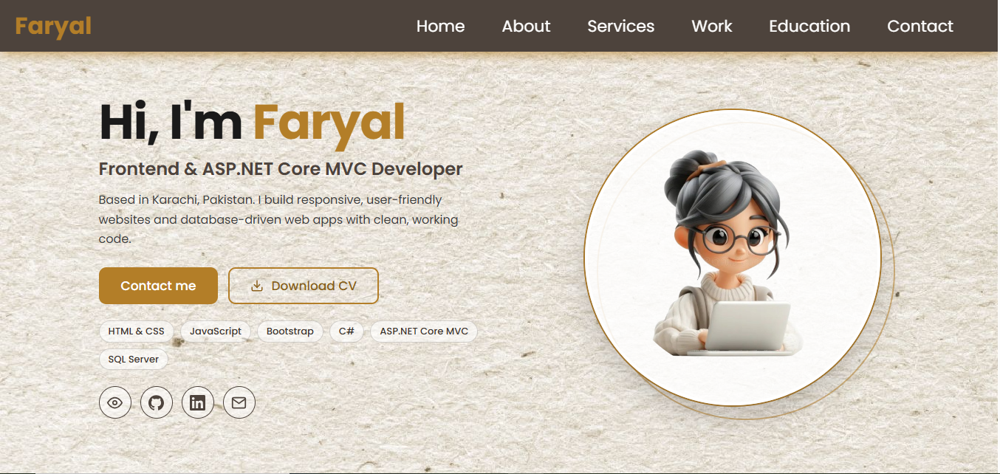
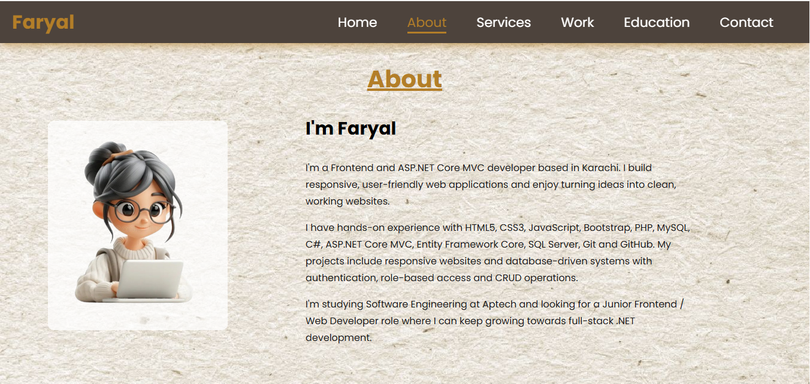
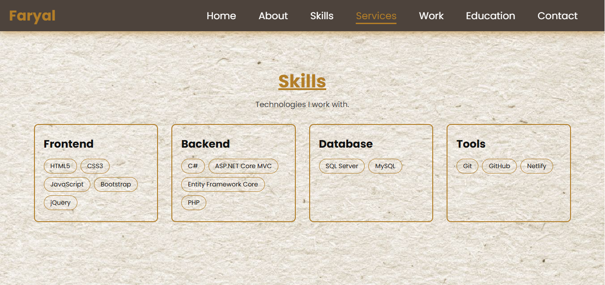
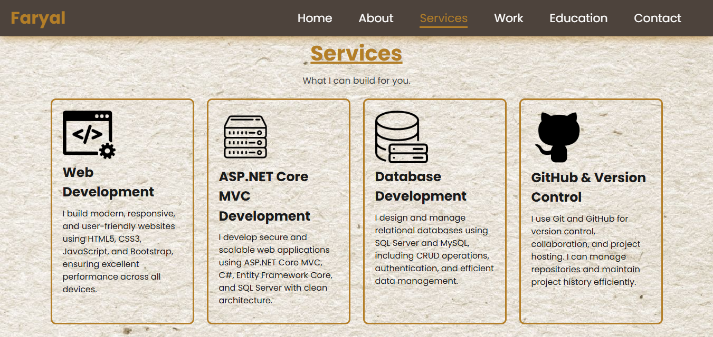
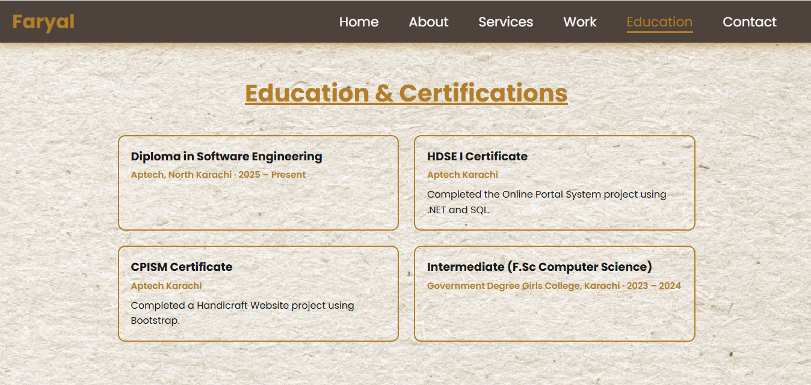
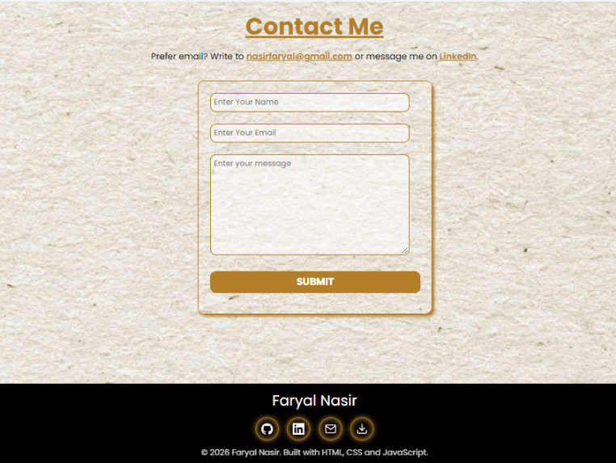
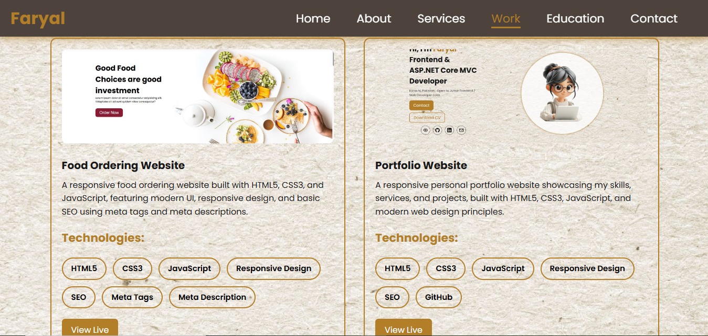
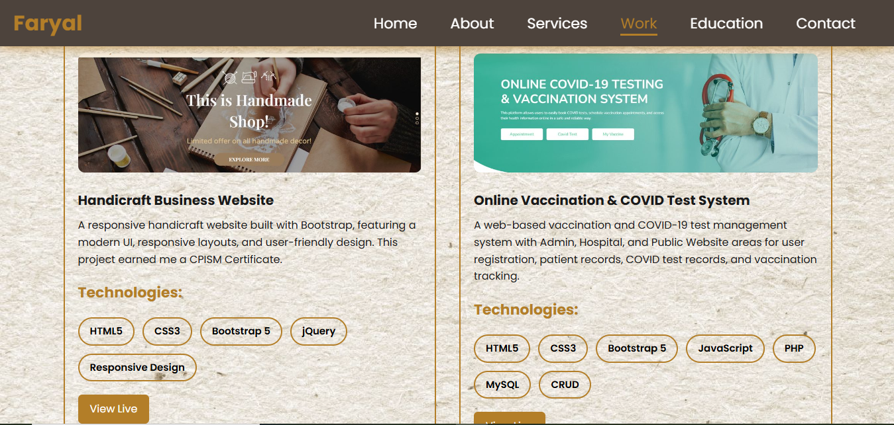
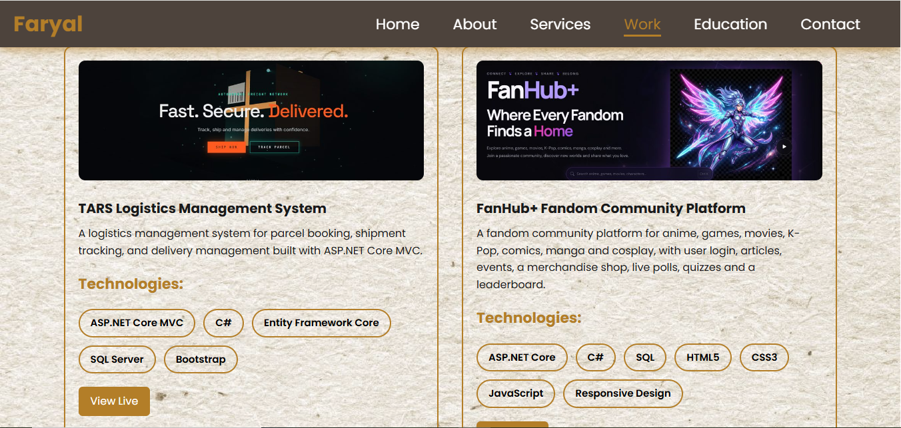
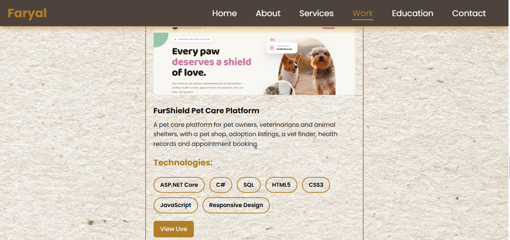

# Personal Portfolio – Faryal Nasir

## About The Project

This is my personal portfolio website, created to showcase my technical skills, educational background, projects, and contact information.

The portfolio represents my journey as a developer and provides an overview of my frontend and ASP.NET Core MVC development skills.

This project was developed as part of the **Oasis Infobyte Internship Program – Web Development and Designing, Level 1, Task 2 (Personal Portfolio).**

## Live Demo
https://faryal.netlify.app

## Features

- Personal hero section with my name, role title, and avatar.
- About Me section introducing my background and interests.
- Dedicated Skills section grouped into Frontend, Backend, Database, and Tools.
- Services section highlighting my development services.
- Work section showcasing 7 projects.
- Education and certifications section.
- Contact form for visitors.
- Navigation links with smooth scrolling.
- Responsive layout for desktop and mobile devices.
- Consistent color scheme and typography.
- Social media links.

## Technologies Used

- HTML5
- CSS3
- JavaScript

## Portfolio Sections

1. Home
2. About
3. Skills
4. Services
5. Work / Projects
6. Education & Certifications
7. Contact

## Projects Showcased

The portfolio features the following projects:

1. Food Ordering Website
2. Portfolio Website
3. Handicraft Business Website
4. Online Vaccination & COVID-19 Test System
5. TARS Logistics Management System
6. FanHub+ Community Platform
7. FurShield Pet Care Platform

## Screenshots

The following screenshots demonstrate the different sections of my portfolio website.

### Home Section

### About Section

### Skills Section

### Services Section

### Education Section

### Contact Section & Footer

### Work / Projects

All screenshots are available in the `screenshots` folder.

## How To Run

1. Download or clone this repository.
2. Open the `WebDev-L1-Portfolio` folder.
3. Open `index.html` in your web browser.

## Internship Details

**Program:** Oasis Infobyte Internship Program

**Track:** Web Development and Designing

**Level:** Level 1

**Task:** Task 2 – Personal Portfolio

## Developer

**Faryal Nasir**

