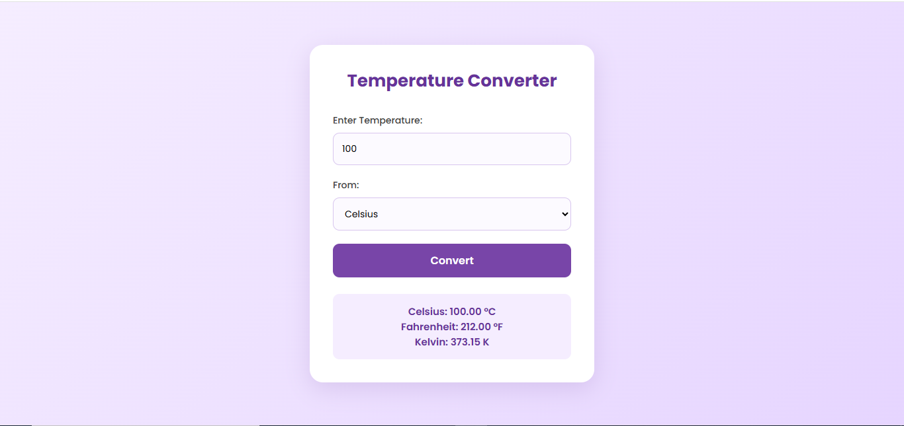
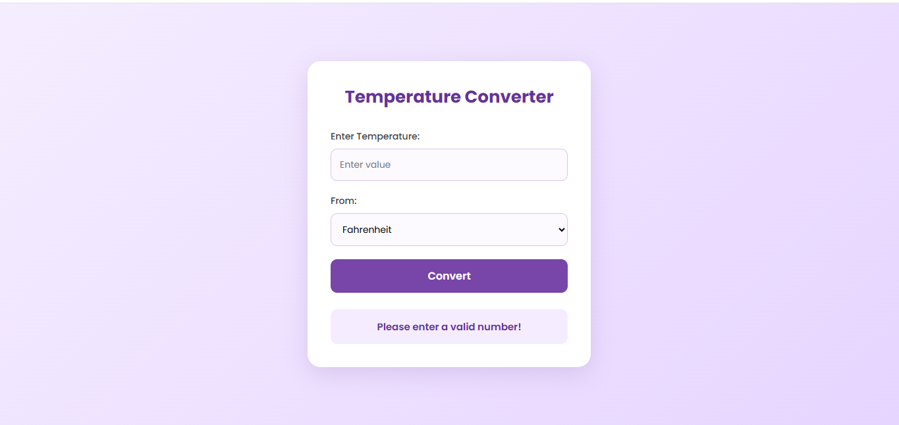
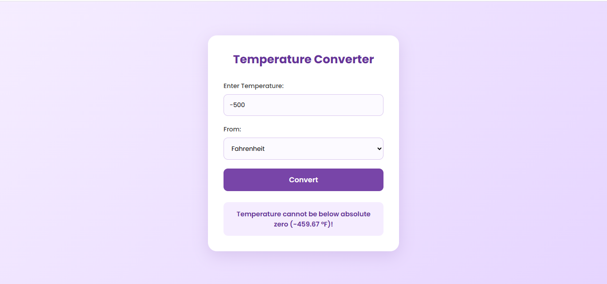

# Temperature Converter

## About the Project
Temperature Converter is a simple and responsive web application that converts temperatures between Celsius, Fahrenheit, and Kelvin.

## Live Demo
https://webdev-l1-temperatureconverter.netlify.app

## Screenshots

## Features
- Convert Celsius to Fahrenheit.
- Convert Fahrenheit to Celsius.
- Convert Celsius to Kelvin.
- Convert Kelvin to Celsius.
- Supports all combinations of temperature units.
- Validates empty and invalid inputs.
- Prevents temperatures below absolute zero.
- Responsive design for mobile devices.
- Shows results in all three units (Celsius, Fahrenheit, Kelvin) at once.

## Technologies Used
- HTML5
- CSS3
- JavaScript

## How to Use
1. Enter a temperature value.
2. Select the unit you are converting from (Celsius, Fahrenheit, or Kelvin).
3. Click the Convert button.
4. The temperature will be shown in all three units: Celsius, Fahrenheit, and Kelvin.

## Project Structure
- `index.html` – Website structure.
- `style.css` – Website styling.
- `script.js` – Temperature conversion functionality.

## Developer
Faryal Nasir

## Internship
AICTE Oasis Infobyte Internship Program – Web Development and Designing